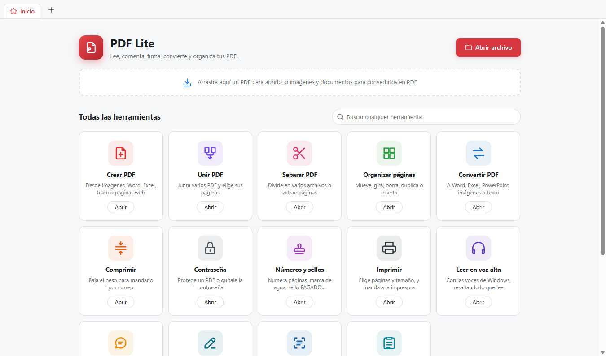
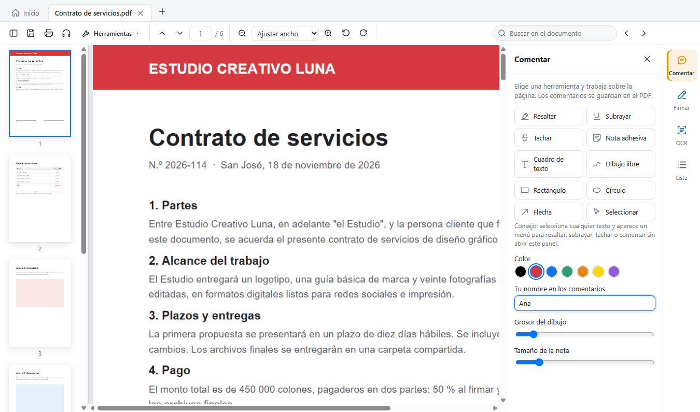
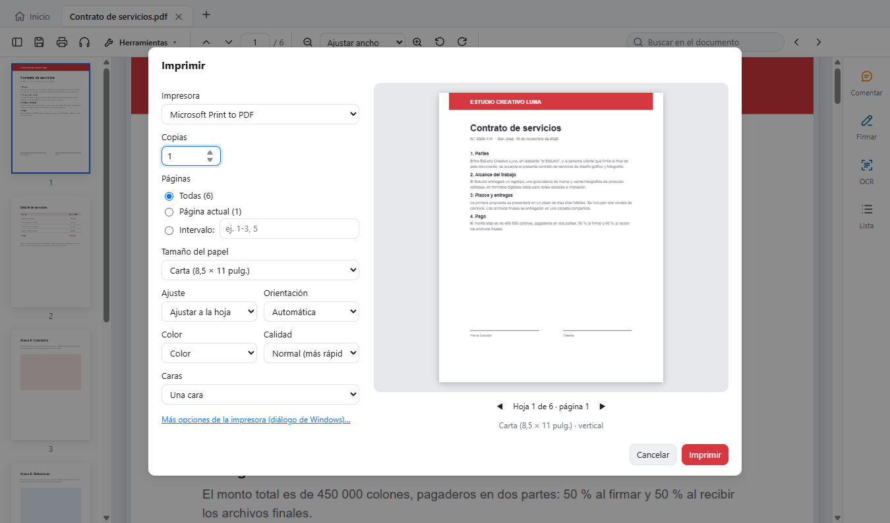
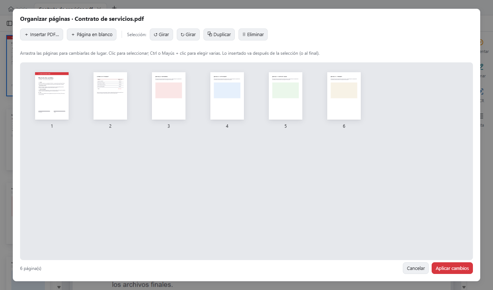
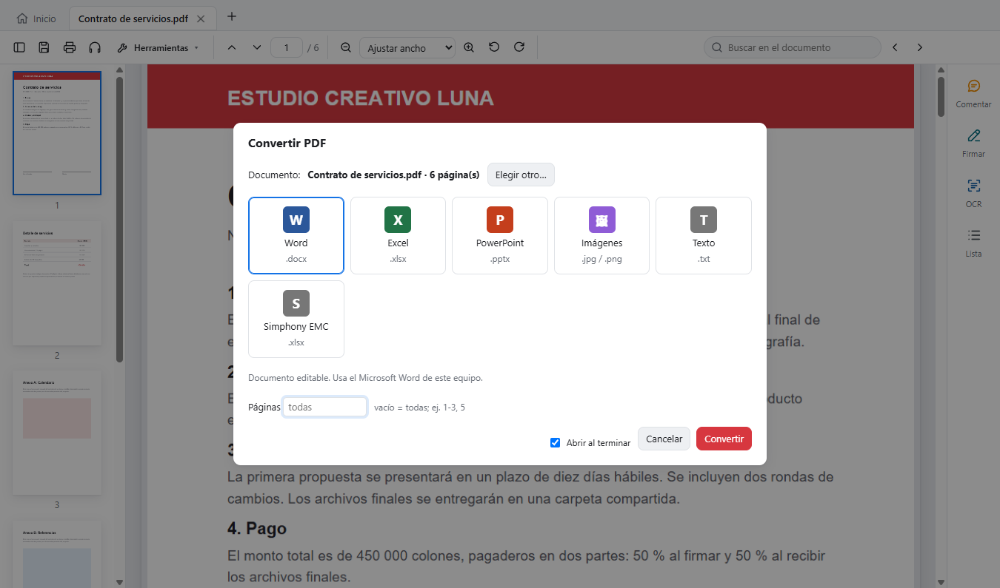
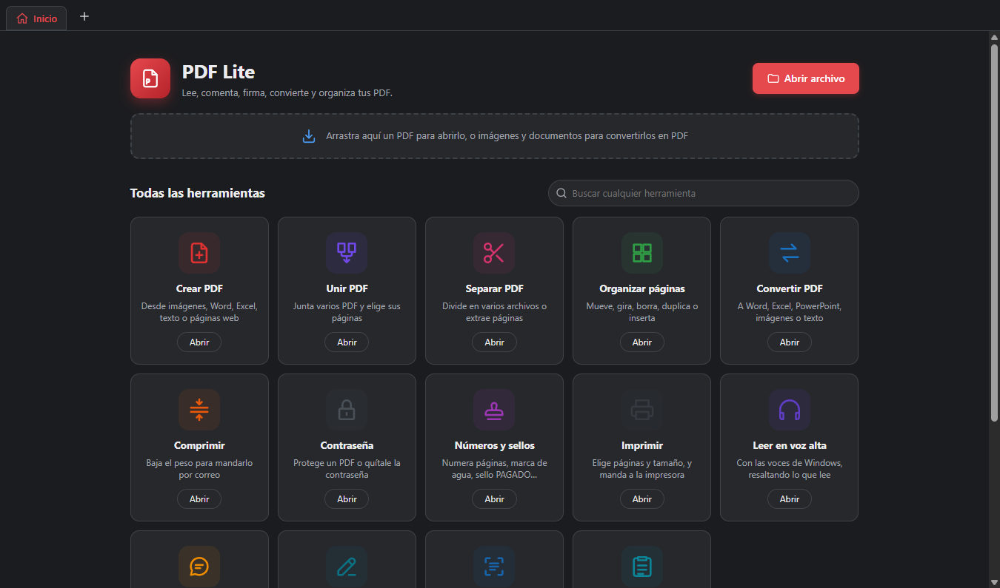

# PDF Lite

**Visor y herramientas de PDF para Windows, gratis y sin anuncios.**
Lee, comenta, firma, convierte y organiza tus PDF. Todo se hace en tu computadora.

## Contenido

- [Instalar](#instalar)
- [Qué puede hacer](#qué-puede-hacer)
- [Capturas](#capturas)
- [Justificaciones en lote](#justificaciones-en-lote-costa-rica)
- [Preguntas frecuentes](#preguntas-frecuentes)
- [Historial de versiones](#historial-de-versiones)

## Instalar

1. Descarga **[PDFLiteSetup.exe](https://github.com/alessio034/pdf-lite-releases/releases/latest/download/PDFLiteSetup.exe)**.
2. Ábrelo. PDF Lite se instala y se abre solo, en unos segundos. No pide permisos de administrador.
3. Si quieres abrir siempre tus PDF con PDF Lite, usa el aviso de la pantalla de Inicio
   (o **Archivo → Usar PDF Lite para abrir los PDF**) y elige PDF Lite en la ventana de Windows.

> [!NOTE]
> **"Windows protegió su PC":** como el programa no está firmado digitalmente, la primera vez
> puede salir ese aviso. Pulsa **Más información → Ejecutar de todas formas**. Solo pasa al instalar.

**Requisitos:** Windows 10 u 11 de 64 bits. Para convertir a Word, Excel o PowerPoint hace falta tener
Microsoft Office instalado; todo lo demás funciona sin él.

**Actualizaciones:** son automáticas. Cuando sale una versión nueva se descarga sola y aparece el botón
**"Reiniciar y actualizar"**.

## Qué puede hacer

| | |
|---|---|
| 📖 **Leer** | Pestañas, miniaturas, zoom, girar, buscar texto, modo oscuro |
| 💬 **Comentar** | Resaltar, subrayar, tachar, notas adhesivas, cuadros de texto, dibujo libre, rectángulos, círculos y flechas. Se guardan como comentarios reales del PDF (se ven en Adobe) |
| ✍️ **Rellenar y firmar** | Llena formularios, escribe donde quieras y pon tu firma (dibujada o escrita) |
| 🔎 **Reconocer texto (OCR)** | Vuelve buscables y copiables los documentos escaneados, sin internet |
| 🎧 **Leer en voz alta** | Con las voces de Windows, resaltando la frase que va leyendo |
| 🖨️ **Imprimir** | Vista previa, impresora, copias, páginas, papel, ajuste, color y doble cara |
| ➕ **Crear PDF** | Desde imágenes, Word, Excel, texto o páginas web (o arrastrándolos a la ventana) |
| 🧩 **Unir, separar y organizar** | Junta varios PDF, divide uno o extrae páginas; mueve, gira, duplica, borra o inserta |
| 🔄 **Convertir** | A Word, Excel, PowerPoint, imágenes (JPG/PNG) o texto |
| 🗜️ **Comprimir** | Baja el peso para mandarlo por correo |
| 🔒 **Contraseña** | Protege un PDF o quítale la contraseña |
| 🔢 **Números y sellos** | Numera páginas, marca de agua, sellos como PAGADO o COPIA |
| 🧾 **Justificaciones en lote** | Llena un formulario PDF por cada factura y arma el resumen (ver abajo) |
| 🍽️ **Simphony EMC → Excel** | Convierte el reporte de *Menu Items* de Oracle Simphony en un Excel limpio |

**Privado:** tus documentos no se suben a ningún lado. Todo, incluido el OCR, se procesa en tu equipo.

## Capturas

<table>
  <tr>
    <td width="50%"> <b>Comentar:</b> resaltar, notas, formas y flechas</td>
    <td width="50%"> <b>Imprimir</b> con vista previa y opciones de la impresora</td>
  </tr>
  <tr>
    <td> <b>Organizar:</b> arrastra, gira, duplica o borra páginas</td>
    <td> <b>Convertir</b> a Word, Excel, PowerPoint, imágenes o texto</td>
  </tr>
  <tr>
    <td colspan="2" align="center"> <b>Modo oscuro</b>, sigue el tema de Windows</td>
  </tr>
</table>

## Justificaciones en lote (Costa Rica)

Pensado para quien tiene que llenar una justificación por cada factura electrónica:

1. Elige el **formulario PDF** de la justificación (un PDF editable).
2. Arrastra las **facturas** (PDF de Hacienda, y su XML si lo tienes). PDF Lite lee la clave de 50 dígitos,
   la fecha, el proveedor, el monto y la moneda.
3. Revisa los datos (lo dudoso sale en amarillo). Puedes **quitar campos** o **marcar campos nuevos**
   directamente sobre la factura.
4. Pulsa **Generar PDF**: sale un solo documento con el **resumen** (tabla automática o tu propio Excel)
   y, por cada factura, la factura y su justificación ya llena.

## Preguntas frecuentes

<b>¿Es gratis? ¿Tiene anuncios?</b>

Sí, es gratis y no tiene anuncios ni pide cuenta.

<b>¿Necesito internet?</b>

No. Solo se conecta para buscar actualizaciones. Todo lo demás, incluido el OCR, funciona sin conexión.

<b>Convertir a Word / Excel / PowerPoint no funciona</b>

Esas conversiones usan el Microsoft Office instalado en tu equipo. Si no tienes Office, puedes
convertir a imágenes o a texto.

<b>¿Cómo sé qué versión tengo?</b>

En **Ayuda → Acerca de PDF Lite**.

<b>¿Cómo lo desinstalo?</b>

Desde **Configuración de Windows → Aplicaciones → Aplicaciones instaladas → PDF Lite → Desinstalar**.

<b>Encontré un error o tengo una idea</b>

Abre un [issue](https://github.com/alessio034/pdf-lite-releases/issues) contando qué pasó
(si puedes, con una captura y la versión que tienes).

## Historial de versiones

| Versión | Novedades |
|---|---|
| **1.2.6** | Ya no pregunta si quieres usar PDF Lite cuando ya es el programa predeterminado |
| **1.2.5** | Diseño nuevo con íconos propios. Imprimir con vista previa, impresora, copias, papel, color y doble cara |
| **1.2.4** | Imprimir (Ctrl+P). Comentarios como en Adobe: menú al seleccionar texto, notas adhesivas y formas, guardados como comentarios reales |
| **1.2.3** | Leer en voz alta con las voces de Windows |
| **1.2.2** | Convertir la lista de *Menu Items* de Simphony EMC a Excel |
| **1.2.1** | Ventana "Acerca de" con versión y contacto |
| **1.2.0** | Justificaciones: elegir qué campos extraer y marcar campos nuevos en la factura |
| **1.1.0** | Primera versión pública |

Todas las versiones y sus instaladores están en [Releases](https://github.com/alessio034/pdf-lite-releases/releases).

---

Hecho por <a href="https://github.com/alessio034">alessio034</a> · Usa <a href="https://mozilla.github.io/pdf.js/">PDF.js</a>, <a href="https://pdf-lib.js.org/">pdf-lib</a>, <a href="https://tesseract.projectnaptha.com/">Tesseract.js</a> y <a href="https://www.electronjs.org/">Electron</a>

